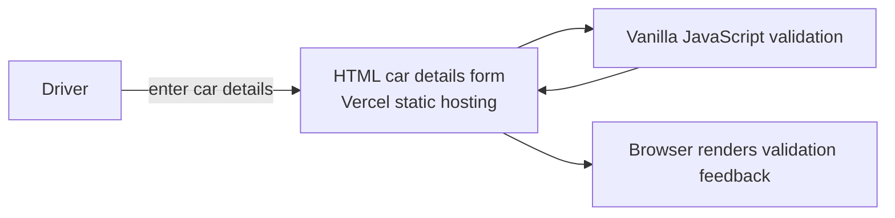

# car-validation-vanilla-js

## Architecture

Car Details Form Validation using Vanilla JavaScript

## Vercel Deployment
This is a static vanilla JavaScript application with no bundler build step. Connect the repository root to Vercel; the root [vercel.json](./vercel.json) publishes the checked-in static files directly. Preview branches receive preview deployments; production follows the configured production branch. No server environment values are needed.

